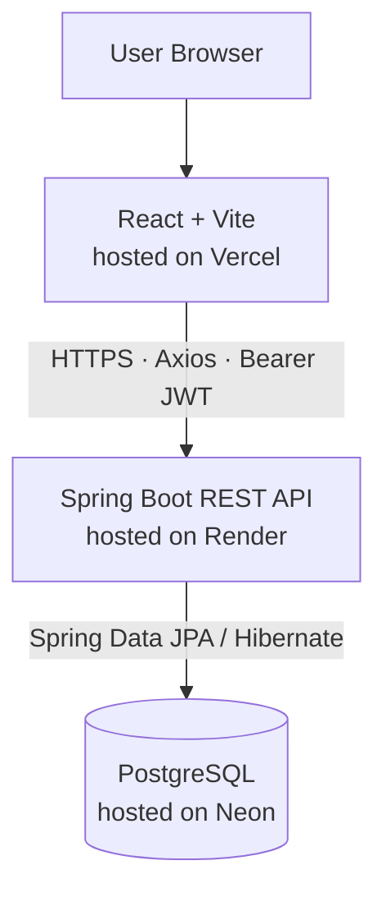
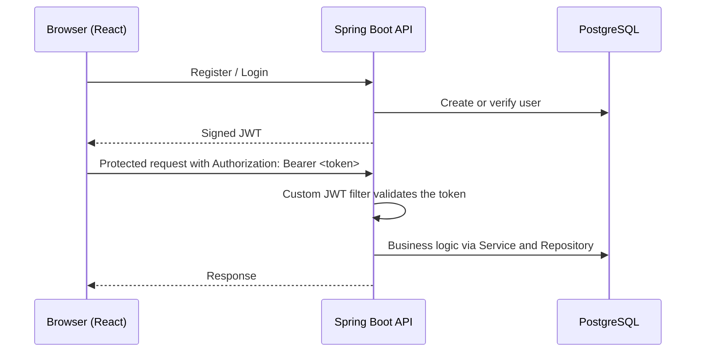

<p align="center">
  
</p>

<h1 align="center">Bharadwaj.ly</h1>

<p align="center">
  <b>A full-stack URL shortener with JWT authentication, deployed end to end in the cloud.</b><br/>
  React + Vite · Spring Boot · PostgreSQL
</p>

<p align="center">
  <a href="https://url-shortener-frontend-by-manu.vercel.app"><b>Live Demo</b></a>
  &nbsp;•&nbsp;
  <a href="https://url-shortener-sb-h9hc.onrender.com"><b>Backend API</b></a>
  &nbsp;•&nbsp;
  <a href="https://youtube.com/@code-with-Bharadwaj"><b>YouTube</b></a>
</p>

<p align="center">
  
  
  
  
  
  
  
</p>

---

## Table of Contents

- [Overview](#overview)
- [Live Deployment](#live-deployment)
- [Architecture](#architecture)
- [Authentication Flow](#authentication-flow)
- [Tech Stack](#tech-stack)
- [Project Structure](#project-structure)
- [Security](#security)
- [Environment Variables](#environment-variables)
- [Run Locally](#run-locally)
- [Engineering Principles](#engineering-principles)
- [Author](#author)

---

## Overview

**Bharadwaj.ly** is a full-stack URL shortening application that is live in production. A React single-page app talks to a Spring Boot REST API, which stores data in a serverless PostgreSQL database.

The project focuses on getting the fundamentals right:

- Stateless JWT authentication with a custom Spring Security filter
- A layered backend: Controller → Service → Repository
- Protected API routes and protected frontend routes
- Explicit, environment-driven CORS configuration
- Configuration and secrets supplied through environment variables, none hardcoded
- A Dockerized backend and a three-provider cloud deployment

---

## Live Deployment

| Layer | Platform | Link |
|-------|----------|------|
| Frontend | Vercel | [url-shortener-frontend-by-manu.vercel.app](https://url-shortener-frontend-by-manu.vercel.app) |
| Backend API | Render | [url-shortener-sb-h9hc.onrender.com](https://url-shortener-sb-h9hc.onrender.com) |
| Database | Neon (serverless PostgreSQL) | managed instance |

---

## Architecture



**Backend request path:** `JWT filter → Controller → Service → Repository → Database`

---

## Authentication Flow



The server keeps no session state. Every protected request carries its own token.

---

## Tech Stack

### Backend

| Area | Technology |
|------|------------|
| Framework | Spring Boot (`spring-boot-starter-web`) |
| Persistence | Spring Data JPA, Hibernate, PostgreSQL driver |
| Security | Spring Security, JJWT (`io.jsonwebtoken`) |
| Validation | `spring-boot-starter-validation` |
| Utilities | Lombok |
| Build and Deploy | Maven, Docker |

### Frontend

| Area | Technology |
|------|------------|
| Core | React, Vite |
| Routing | `react-router-dom` |
| HTTP | Axios (single centralized instance) |
| Forms | `react-hook-form` |
| UI | Tailwind CSS, Material UI (`@mui/material`), `react-icons` |
| Feedback | `react-hot-toast` |
| State | Context API (global auth state) |

---

## Project Structure

Monorepo with a separate backend and frontend.

```text
url-shortener-fullstack/
│
├── backend/
│   ├── controller/        # REST endpoints (Auth, URL APIs)
│   ├── service/           # Business logic layer
│   ├── repository/        # JPA repositories
│   ├── model/             # Entity classes (User, Url)
│   ├── security/          # JWT filter, CORS config, security setup
│   ├── resources/
│   │   └── application.properties
│   ├── pom.xml
│   └── Dockerfile
│
├── frontend/
│   ├── api/               # Axios configuration
│   ├── components/        # Reusable UI components
│   ├── contextApi/        # Global authentication state
│   ├── pages/             # Login, Register, Dashboard
│   ├── routes/            # Protected routing logic
│   ├── package.json
│   └── vite.config.js
│
└── README.md
```

---

## Security

- JWT-based, stateless authentication
- Bearer token validation through a custom filter
- Protected API endpoints and protected frontend routes
- CORS restricted to the configured frontend origin
- No hardcoded credentials; all secrets come from environment variables

---

## Environment Variables

Create these before running or deploying. Never commit real values.

### Backend

| Variable | Purpose |
|----------|---------|
| `DATABASE_URL` | PostgreSQL connection URL |
| `DATABASE_USERNAME` | Database user |
| `DATABASE_PASSWORD` | Database password |
| `JWT_SECRET` | Secret used to sign and verify JWTs |
| `FRONTEND_URL` | Frontend origin allowed through CORS |

### Frontend

| Variable | Purpose |
|----------|---------|
| `VITE_BACKEND_URL` | Base URL of the backend API |
| `VITE_REACT_SUBDOMAIN` | Frontend subdomain setting |

---

## Run Locally

### Prerequisites

- A JDK compatible with the version configured in `backend/pom.xml`
- Node.js and npm
- A PostgreSQL database (local, or a Neon project)

### 1. Clone

```bash
git clone https://github.com/manu577228/url-shortener-fullstack.git
cd url-shortener-fullstack
```

### 2. Start the backend

Set the backend environment variables listed above, then:

```bash
cd backend
./mvnw spring-boot:run
```

### 3. Start the frontend

Set the frontend environment variables (for example in a `.env` file inside `frontend/`), then:

```bash
cd frontend
npm install
npm run dev
```

Open the local URL that Vite prints in the terminal.

---

## Engineering Principles

- **Separation of concerns:** controller, service, repository and model layers on the backend; pages, components, API and routes on the frontend
- **Stateless backend:** authentication travels with every request
- **Environment isolation:** the same code runs locally and in production, with differences kept in configuration
- **Secure defaults:** protected routes, restricted CORS, no secrets in source control

---

## Author

<p align="center">
  <b>Manu Bharadwaj</b><br/>
  Software Engineer · Full-Stack Developer
</p>

<p align="center">
  <a href="https://www.linkedin.com/in/manu-bharadwaj-3507a345/">
    
  </a>
  &nbsp;
  <a href="https://youtube.com/@code-with-Bharadwaj">
    
  </a>
</p>

---

<p align="center">
  If you find this project useful, consider giving it a ⭐
</p>
